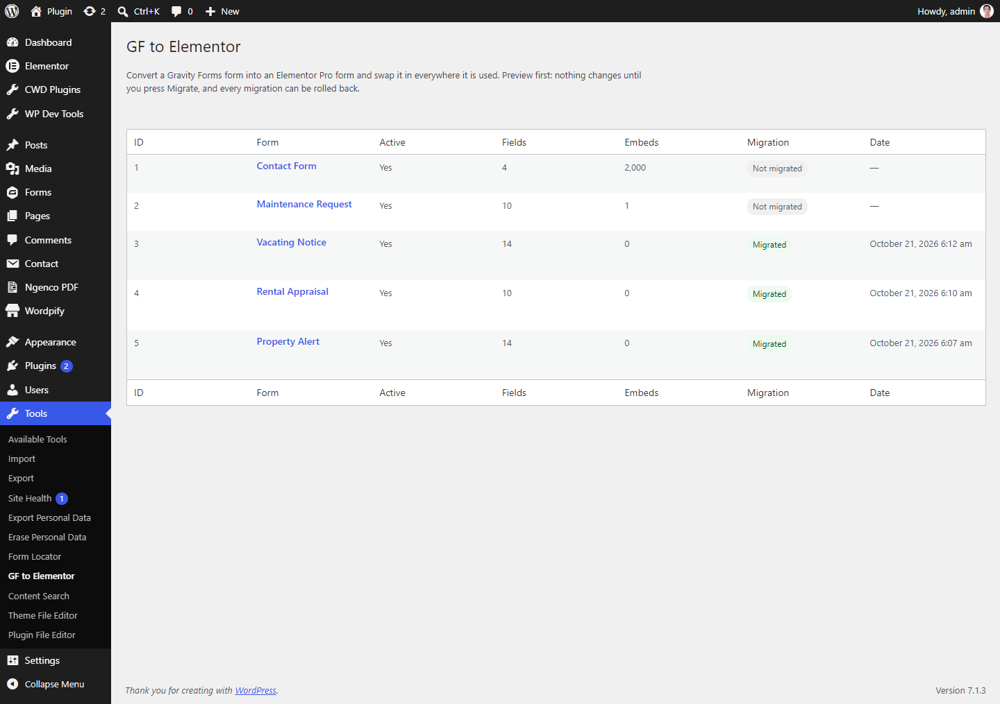
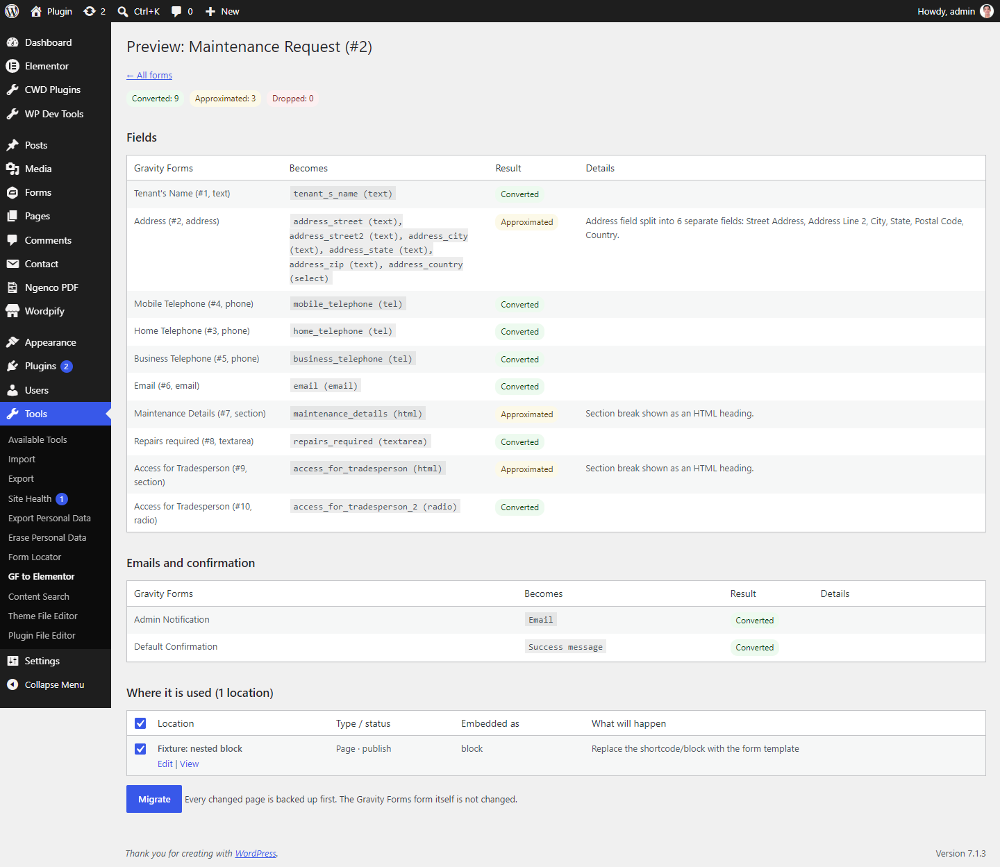
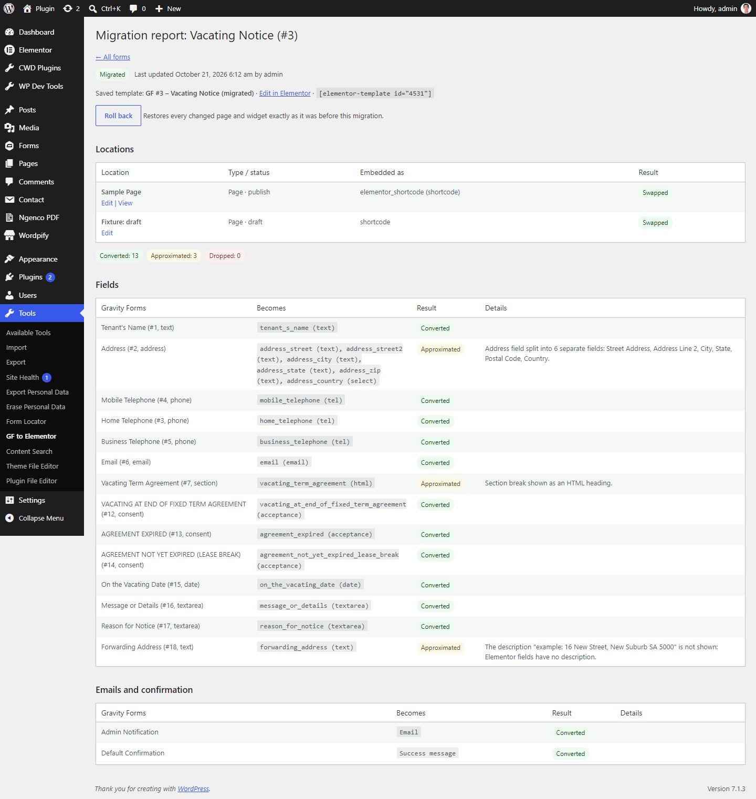

# Web of D GF to Elementor

Converts Gravity Forms forms into Elementor Pro forms, then swaps the new form into every place the old one is embedded. Each changed page or widget is backed up first, and each form's migration can be rolled back with one click.



> Gravity Forms **entries are not migrated**. Only the form itself (fields, notifications and confirmations) and its embeds are converted.

## Features

- **Preview first.** Nothing changes until you press **Migrate**. The preview shows how each field converts, labelled **Converted**, **Approximated** (with the reason) or **Dropped**.
- **Field mapping.** It converts text, textarea, select, multiselect, checkbox, radio, number, email, phone, website, date, time, file upload, hidden, HTML, section, page (multi-step), name, address, consent, list, product, total, captcha and post fields.
  - Composite fields such as Name and Address are split into separate Elementor fields.
  - Gravity Forms pages become Elementor steps, and the honeypot setting is carried over.
- **Notifications and confirmations.** These become the Elementor form's Email action and success message, with merge tags rewritten.
- **Embed swapping.** It finds and replaces the form in:
  - `[gravityform]` shortcodes in post content and post meta (ACF, page builders)
  - `gravityforms/form` blocks, including nested ones
  - Elementor shortcode and Gravity Forms widgets in Elementor data
  - classic and block widgets
- **Saved template.** Each converted form is saved as an Elementor template and embedded with `[elementor-template id="…"]`.
- **Backups and rollback.** Every changed post, Elementor document or widget is backed up before writing. **Roll back** restores all of them exactly.
- **Migration report.** For each migration, it lists which locations were swapped and the field-by-field result.
- **Multisite-aware.** Uninstall cleans up every site on the network.

## Screenshots

| Preview | Migration report |
|---|---|
|  |  |

## Requirements

- WordPress 6.0+
- PHP 8.1+
- Elementor and **Elementor Pro** (for the Form widget)
- The Gravity Forms data on the site. The Gravity Forms plugin can be inactive, as long as its tables are still there.

## Installation

### From a release zip
Download the zip and upload it under **Plugins → Add New → Upload Plugin**, then activate it.

### From source
```bash
cd wp-content/plugins
git clone https://github.com/slightgrey/webofd-gf-to-elementor.git
cd webofd-gf-to-elementor
composer install --no-dev
```
Then activate **Web of D GF to Elementor**. The plugin needs `vendor/autoload.php` (Composer's PSR-4 autoloader), so `composer install` must run before you activate it.

## Usage

1. Go to **Tools → GF to Elementor**.
2. Click a form to open its preview, and check the field mapping and the list of locations.
3. Untick any locations you don't want swapped, then click **Migrate**.
4. Open the migration report to check the results. Use **Roll back** to undo.

## Permissions

By default the tool needs the `manage_options` capability. You can change this with a filter:

```php
add_filter( 'gf2el_capability', fn() => 'edit_pages' );
```

## REST API

All routes are under `/wp-json/gf2el/v1` and check the capability above.

| Method | Route | Purpose |
|---|---|---|
| GET | `/forms/{id}/preview` | Conversion preview and embed list |
| POST | `/forms/{id}/migrate` | Create the Elementor template and start a migration |
| POST | `/migrations/{id}/embeds/{key}` | Swap one embed |
| POST | `/migrations/{id}/finalize` | Mark the migration complete |
| POST | `/migrations/{id}/rollback` | Restore all backups for a migration |

## Development

```bash
composer install
composer test      # PHPUnit
composer lint      # PHPCS (WordPress Coding Standards + PHPCompatibility)
composer analyse   # PHPStan
php scripts/build-zip.php   # builds webofd-gf-to-elementor-v{VERSION}.zip
```

The build script installs production dependencies in a temporary staging copy, so your working `vendor/` is never touched.

## Uninstall

Deleting the plugin removes the `gf2el_migrations` and `gf2el_backups` tables, its options and transients, and the `_gf2el_source_form` post meta on every site. Elementor templates it created are kept.

## License

GPL-2.0-or-later, as declared in the plugin header. The bundled [LICENSE](LICENSE) is the GPL-3.0 text, which the "or later" clause allows.
